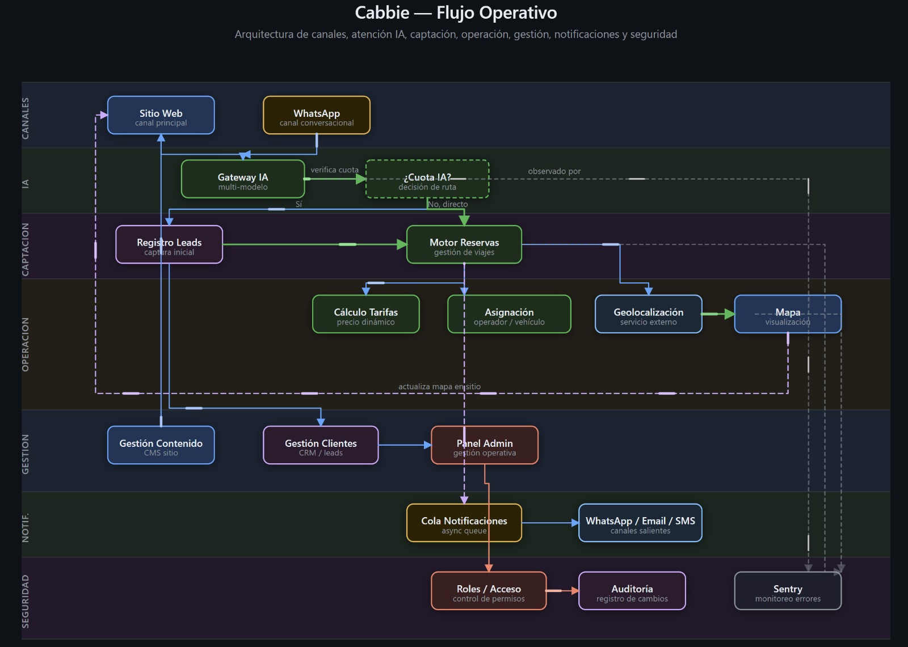

# Reyvit Cisneros (MattReyvit)

## Especialista en Desarrollo de Producto con IA

Diseño y entrego productos digitales completos — arquitectura, datos, privacidad y SEO — usando la IA como acelerador, con un método documentado.

> ### 🚀 Caso destacado: [Cabbie — Case Study](https://reyvit-cisneros.github.io/cabbie-case-study/)
> Plataforma de taxi y movilidad: arquitectura, datos, privacidad y flujos con motion.

🇬🇧 [English version](README.md)

## Qué aporto
- **Arquitectura de producto**: del PRD a producción, con customer journeys y modelos de datos.
- **Datos y seguridad**: PostgreSQL, seguridad por filas, triggers, auditoría, privacidad desde el diseño.
- **Cumplimiento normativo**: experiencia con la Ley 29733 (Perú) y facturación electrónica, trasladable a RGPD / LOPDGDD.
- **Crecimiento orgánico**: SEO técnico, datos estructurados y preparación para buscadores con IA (GEO).

## Proyectos destacados
- [cabbie-case-study](https://github.com/Reyvit-Cisneros/cabbie-case-study) — plataforma de reservas de principio a fin.
- [reyvit-framework](https://github.com/Reyvit-Cisneros/reyvit-framework) — mi método de entrega.
- [comprobante-express-case-study](https://github.com/Reyvit-Cisneros/comprobante-express-case-study) — producto regulado de facturación.

## Contacto
GitHub: [github.com/Reyvit-Cisneros](https://github.com/Reyvit-Cisneros)

Los datos de contacto viven en mi perfil de GitHub, así hay un solo lugar donde actualizarlos.
